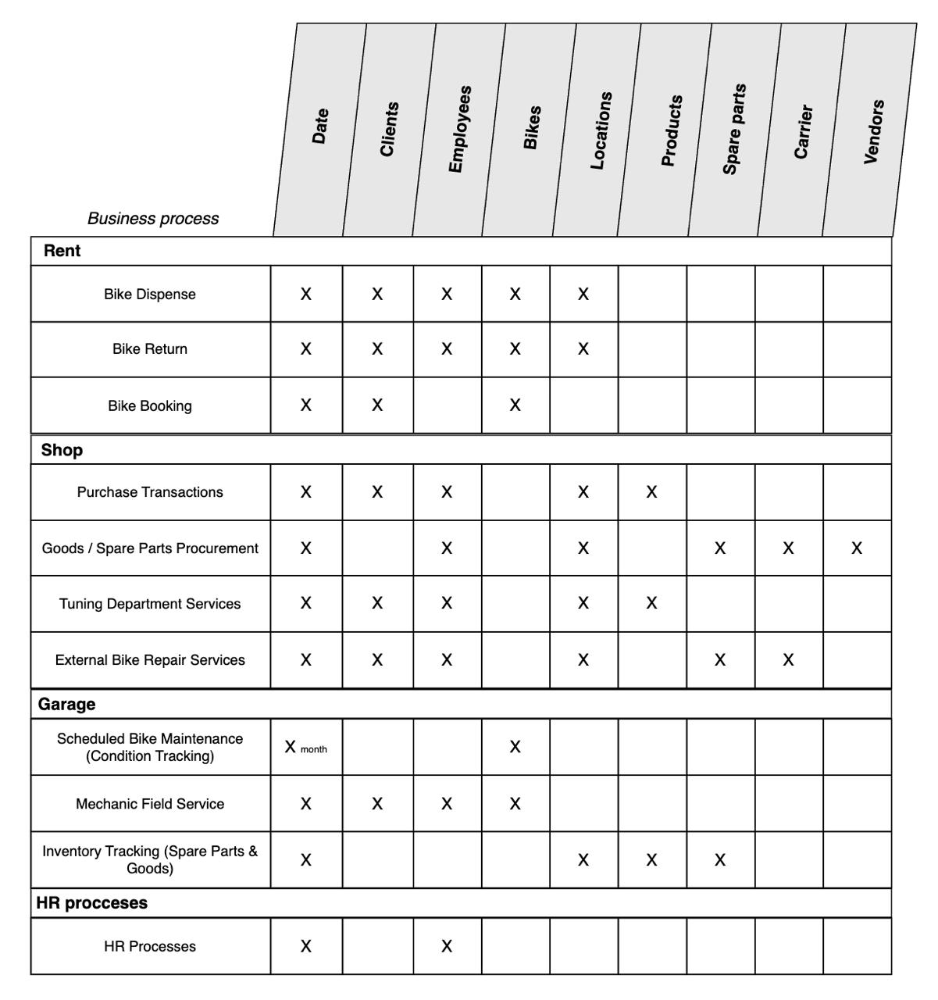

# Project Overview

Let's outline the core business processes of our startup from a data modeling perspective. The business operates as a large-scale bike (scooter) rental service in Bangkok, but it also features a fully-fledged retail shop, a tuning department, and a garage (workshop) that services both the rental fleet and external client bikes brought in for repair and maintenance. Thus, the company consists of three major departments:

- **Shop**
- **Garage (Workshop)**
- **Rental**

All three departments overlap and directly or indirectly impact each other's efficiency. Therefore, they require a robust data organization system to act as the "glue" binding all units into one large, efficient mechanism.

Let's examine each department in more detail.

## "Shop" Department

This department includes the physical retail store where clients can purchase various bike accessories and spare parts. It also houses a tuning unit that provides installation services for purchased accessories and handles cosmetic repairs (which do not require significant structural modifications to the bike). The shops function as distinct physical locations that clients can visit to make purchases.

The Shop department interacts directly with the Garage department because the Shop serves as the entry point for purchasing new bikes and spare parts. The Shop is responsible for the timely procurement of inventory and its subsequent delivery (as well as handling returns, if necessary) to the garages and rental spots. For instance, if the garage needs a new engine for a Honda Click, the mechanics submit a request to the Shop team, who then initiate the procurement pipeline for the required parts. Similarly, the Rental department can request the Shop to purchase a new batch of bikes based on demand analytics and seasonality.

Clients also have the option to visit the shop and request a comprehensive repair service for their personal bikes. Suppose a client arrives on their own bike and wants full maintenance. They purchase new spare parts and accessories in the shop and leave the bike with the tuning department. The Shop team then contacts the Garage team and transfers the client's bike for repairs. Once the work is completed, the Garage team sends the bike back to the shop, where it is handed over to the client.

The following business processes take place within the Shop department:

- **Purchase transactions**: Client purchase events captured down to the granularity of individual receipt line items.
- **Tuning department services**: Events related to installing purchased parts on a client's bike (e.g., installing a rear top box on a Honda ADV 160).
- **Personal bike repair services**: This refers to the external repair pipeline for a client's own bike. The pipeline spans from the client purchasing the necessary parts (if needed) to transferring the bike to the garage, and finally returning the finished bike to the shop for client pickup.
- **Parts or bikes procurement facts**: This covers the complete procurement pipeline, including interactions with vendors and carriers. (Note: The physical movement of parts between the shop and the garage is handled by the company's own pickup trucks; we will exclude these internal transfers from the data model due to their implementation complexity).

## "Garage" Department

This unit handles the scheduled maintenance and repair of the rental bike fleet, as well as any external client bikes forwarded from the Shop. This department operates entirely behind the scenes; clients do not interact with garage-only locations. In the event of a technical issue during a rental, the client first calls the Rental support team, who then contact the garage mechanics to dispatch someone to the client's location.

The Garage also serves as a spare parts warehouse and temporary storage facility for bikes that don't fit at the rental locations. These might be brand-new bikes awaiting local transport department registration (bikes without license plates) or bikes waiting for ordered parts to arrive before repairs can begin. This is crucial to prevent clutter at the rental spots, where physical space is highly limited.

The business processes here include:

- **Scheduled bike maintenance**: This involves managing a maintenance calendar, which logically falls under this department's purview. Naturally, the physical work (oil changes, filter replacements, etc.) is performed in the garage.
- **Mechanic field service dispatches**: This process is triggered when a client needs on-the-road assistance with a technical issue, and a mechanic personally travels to the specified location (e.g., to fix a flat tire or jump-start a dead battery).
- **Spare parts inventory tracking**: The garage plays a critical role here, as the Shop relies on the garage's current stock levels to make procurement decisions. Inventory levels fluctuate based on part quality, tool usage frequency, and accidental damage. Only the mechanics can accurately specify what is currently needed for the fleet.

## "Rental" Department

The Rental division directly manages the bike dispense and return processes, ensuring technical conditions are accurately logged upon return. Furthermore, clients can consult with rental agents regarding the handling characteristics of specific bikes and receive recommendations for popular tourist routes. The Rental department also manages customer support, fielding calls and logging tickets for mechanic field dispatches to resolve technical problems.

The Rental department may consult with the Shop regarding the procurement of new bikes, helmets, and gear. We highlight the following key business processes:

- **Bike dispense**: The process of handing a bike over to a client, which includes logging its technical condition and setting the rental start date and cost. If a client requests a bike swap during their rental period, strict data collection rules dictate a complete return process for the current bike and the creation of a new rental fact. The client must also book the replacement bike in the app after closing the current rental.
- **Bike return**: The fact of a bike being returned, capturing its final technical condition.
- **App booking**: This occurs exclusively on the client side. Booking involves selecting a bike model and specifying the rental period.

## Enterprise Bus Matrix

To determine which dimensions will intersect with each business process, it is vital to construct an Enterprise Data Warehouse Bus Matrix. This schema provides a clear visualization of how different business departments overlap and which dimensions demand the most engineering focus. In this matrix, business processes are mapped as rows, while potential dimensions (essentially our business assets) are expanded across the columns.

