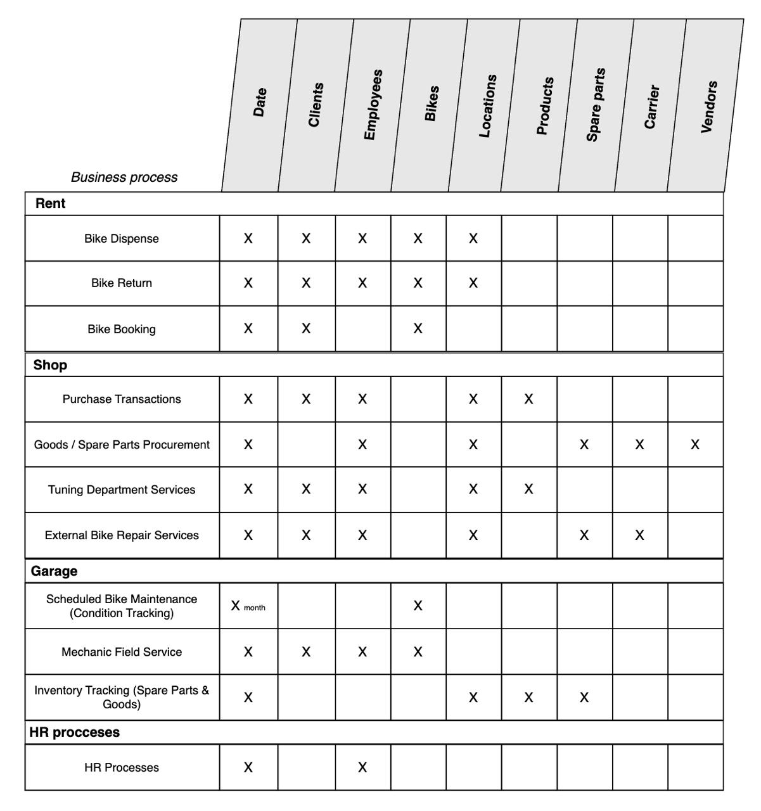

# Enterprise Bus Matrix

The Enterprise Data Warehouse Bus Matrix serves as the architectural foundation for incrementally building a data warehouse. This tool allows us to break down a massive data integration task into manageable phases while maintaining a unified vision. In Kimball's methodology, the matrix is the master plan, ensuring that data marts developed asynchronously will eventually snap together into a cohesive system.

Matrix Structure:

- **Rows (Business Processes):** Reflect the core operational events of the company (e.g., bike dispense, parts ordering, repairs), rather than the organizational structure or departmental hierarchy. Each process ultimately translates into a fact table.
- **Columns (Conformed Dimensions):** Represent the unified enterprise reference data (conformed dimensions), such as Date, Client, Location, or Bike.
- **Intersections (Cells):** The marked cells visualize the relationships, explicitly indicating which dimensions apply for filtering and aggregating the facts of a specific business process.

The matrix enables an agile DWH development approach. By implementing the system row by row, the team relies on reusable, build-once conformed dimensions. This not only shortens the development cycle for new data marts but also empowers business users to perform cross-process analysis (drill-across) — seamlessly joining metrics from different business processes in a single report, relying on identical dimension attributes.

After an extensive process of analyzing and outlining potential processes, we arrived at the following matrix:

