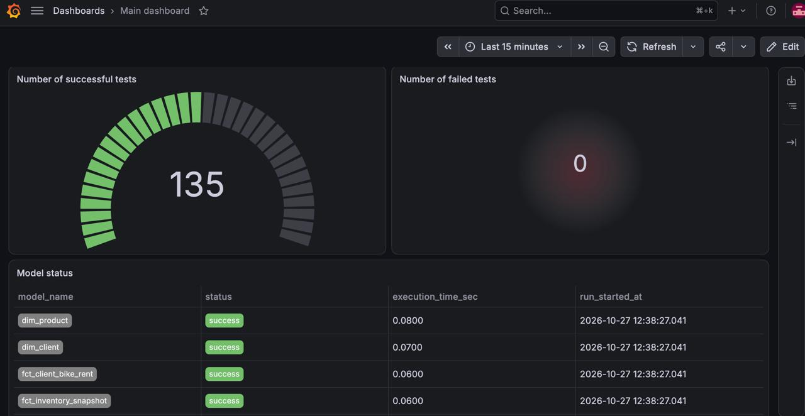

# Data Quality & Observability (Audit)

## Introduction
This section details the Data Quality and Data Observability framework embedded within our ELT pipeline. Guaranteeing the consistency and business-logic accuracy of the data is an absolute prerequisite for securing business users' trust in the warehouse.

We implemented an automated testing suite inside the dbt project and a custom logging mechanism for execution artifacts to visualize the warehouse's health in Grafana.

---

## 1. dbt Testing Suite (Data Quality Tests)

The testing framework is designed to cover both basic technical constraints and complex business domain logic. All tests can be grouped into three core categories.

### 1.1 Column Tests
Foundational validations at the individual field level, configured declaratively in the `schema.yml` file.
*   **Unique and Not Null:** Applied to all surrogate and degenerate keys (e.g., `client_sk`, `rental_id`).
*   **Domain Constraints (Accepted Values):** Defends against "garbage" values creeping into reference tables. For instance, in `dim_bike_condition`, the `rental_condition_score` field is strictly confined to values between 1 and 10, and the day of the week in the calendar is limited to 1 through 7.

### 1.2 Structure and Integrity Tests
Validations guaranteeing relationship integrity and data structures, also defined in `schema.yml`:
*   **Composite Keys:** For the `brg_emp_hierarchy` bridge table, the `dbt_utils.unique_combination_of_columns` macro is used to validate the manager-subordinate combination (`manager_employee_id`, `subordinate_employee_id`).
*   **Active Slice Integrity:** In SCD2 dimensions (like `dim_client` and `dim_employee`), the natural business key is inherently non-unique across the whole table, but it **must** be strictly unique for the currently active slice. This is enforced via a custom `where: "current_row_indicator = true"` condition injected into the uniqueness test.

### 1.3 Custom Business Tests
Complex validations implemented as standalone SQL files inside the `tests/` directory. They verify whether the data makes actual business sense. If one of these SQL queries returns even a single row, the test is marked as failed.

*   **CTE + UNION ALL Pattern:** We consolidate multiple logically related checks for a single data mart into one file to simplify debugging and reduce database load. Each business rule is evaluated in its isolated CTE, and the results are appended with a textual error flag (e.g., `error_reason = 'invalid_date_chronology'`). This allows for immediate problem localization if the pipeline crashes.
*   **SCD2 Interval Validation:** The `dim_clients_scd2_intervals.sql` file houses complex logic to hunt down anomalies in client history: date inversions (start is after end), gaps, or overlaps between versions, alongside validating the active record placeholder (date 9999-12-31).
*   **Math and Finances:** Custom tests (like `assert_client_amounts_logic.sql` and checks inside facts) ensure that final totals perfectly align with formulas: `(Days * Rate) - Discount + Deposit Deductions`, and that cumulative LTV equals total spend across all departments. Bike specification sanity is verified in `dim_bikes_valid_specs.sql` (flagging bikes manufactured before 1990, or boasting zero engine displacement or price).
*   **Complex Logic Chains and Chronological Referential Integrity:** In `fct_rent_extension_chain.sql`, we audit rental extensions, ensuring that if an extension flag is raised, the subsequent rental for that exact client and bike actually exists in the database. Crucially, the join is executed on the immutable natural key to prevent false positives caused by SCD2 client version changes occurring mid-rental (SCD2 Time Travel Trap).

#### Project Custom Tests Registry (`tests/` directory)
Below is a list of all SQL files in the `tests/` directory, briefly describing their business intent:

*   **`assert_client_amounts_logic.sql`** — Verifies that a client's cumulative LTV strictly equals the sum of their historical spending on rentals, shop purchases, and external repairs.
*   **`assert_ops_lead_time_logic.sql`** — Validates the mathematical convergence of timelines: days rented + idle time equal calendar month days, and the sum of delivery/repair stages equals total Lead Time.
*   **`dim_bikes_valid_specs.sql`** — Catches bikes with negative prices, horsepower, zero engine volume, or invalid manufacturing years.
*   **`dim_calendar_no_gaps.sql`** — Guarantees no date gaps (holes) exist across the entire generated calendar timeline.
*   **`dim_clients_completeness.sql`** — Ensures all clients from the raw layer made it into the mart and that every client has exactly one active record.
*   **`dim_clients_scd2_intervals.sql`** — Hunts for SCD2 versioning anomalies: date overlaps, history gaps, and invalid archive record closing dates.
*   **`dim_location_valid_business_rules.sql`** — Checks that every location has at least one active business department and that rental event locations physically exist in the reference table.
*   **`fct_client_bike_rent_business_logic.sql`** — Comprehensive rental test (7 checks): date chronology, receipt financial math, employee permissions, condition-to-mileage alignment, and penalty justification.
*   **`fct_inventory_snapshot_business_logic.sql`** — Comprehensive warehouse test (5 checks): availability flag consistency, planned delivery date logic, exclusion of services from physical stock, and snapshot capture day.
*   **`fct_procurement_business_logic.sql`** — Comprehensive procurement test (4 checks): vendor delivery chronology, invoice/receipt presence, and positive purchase amounts.
*   **`fct_rent_extension_chain.sql`** — Verifies that a closed rental flagged as "extended" is genuinely followed by a physically created new rental event.
*   **`fct_rent_helmet_damage.sql`** — Guarantees a client cannot be penalized for a damaged helmet if no helmets were ever issued to them.
*   **`fct_repair_business_logic.sql`** — Comprehensive client bike repair test (4 checks): shop-to-garage logistics chronology, discount sanity, and mechanic permissions.
*   **`fct_service_events_business_logic.sql`** — Comprehensive field service test (4 checks): dispatch linked to an active rental, dispatch cost > 0, and valid mechanic permissions.
*   **`fct_shop_order_business_logic.sql`** — Comprehensive retail shop test (5 checks): base price vs. discount convergence, physical shop presence at the location, and strict quantum (qty = 1) for tuning services.

---

## 2. Populating the Audit Schema (Parsing dbt Results)

To ensure model and test results aren't just buried in terminal logs, we implemented a mechanism to capture them into the database. This is handled by the `upload_dbt_results.py` Python script, which runs as the final step in the Airflow DAG.

**Technical Implementation Details:**
*   The script reads the system JSON file `analytics/target/run_results.json`, generated by dbt after every project build.
*   Using the `unique_id` prefixes, the script separates entities into tests (`test.`) and models (`model.`).
*   Data for each executed model (name, status, execution time) is loaded into the `audit.dbt_model_results` table.
*   Data for tests (test name, status, failure count, execution time) is loaded into the `audit.dbt_test_results` table.

This custom parser eliminates reliance on bulky third-party dbt packages or external SaaS solutions, giving us complete control over our logging layer.

---

## 3. Data Observability Dashboard (Grafana)

The pipeline metrics visualization layer is built using Grafana, which serves as a "health monitor" (Observability) for the data engineer.

**Operational Principles and Features:**
*   **Data Sources:** Grafana connects to our PostgreSQL database and builds visualizations exclusively using data from the `audit` schema (the `dbt_test_results` and `dbt_model_results` tables).
*   **Real-Time Monitoring:** Dashboards display the recalculation duration for each mart, the percentage of successful loads, and lists of failed business tests. If, for instance, the `fct_procurement_business_logic` test fails, the engineer immediately sees it on the chart and can rapidly localize the issue.
*   **Persisted Volumes (State Preservation):** In the local architecture (`docker-compose.yml`), Grafana's configuration and database directories are mounted to the host's local file system (`./grafana_data` -> `/var/lib/grafana`). This critical architectural decision ensures that configured DB connections, created users, and assembled dashboards survive the complete destruction (`docker-compose down -v`) and recreation of containers.