# Cloud Migration & Multi-Warehouse Architecture (Snowflake)

## Introduction

In `02_Technical_Architecture`, PostgreSQL 15 was intentionally chosen as the initial DWH engine to minimize operational expenses (OPEX) during the startup's early stage while preserving a clean migration path to a cloud-native MPP warehouse. 

This document details the **Multi-Warehouse (Cross-Adapter)** evolution of the **Top Bikes Bangkok** data platform. Instead of replacing the local PostgreSQL stack, the dbt project and ingestion layer were extended to support **Snowflake Enterprise Edition (AWS Singapore)** as a second, cloud-native target. The exact same Kimball dimensional model—17 Core tables, 8 Aggregation marts, 7 Subset views, and 159 automated data tests—now builds seamlessly on either engine via a single flag (`dbt build --target dev` vs. `dbt build --target snowflake`).

---

## 1. Cloud Infrastructure as Code (IaC), RBAC & FinOps Guardrails

All Snowflake infrastructure was provisioned declaratively via SQL (`snowflake/setup_infra.sql`), following enterprise security and cost-governance best practices rather than operating under a single monolithic superuser.

### 1.1 Storage Layer (Medallion + Kimball)
A dedicated database `TOP_BIKES_DWH` was created with a **7-day Time Travel** retention window (`DATA_RETENTION_TIME_IN_DAYS = 7`) and five logical schemas mirroring the local architecture:
* `ODS_EVENTS` — Bronze layer: raw semi-structured events stored in native `VARIANT` columns.
* `STAGING` — Silver layer: typed views acting as data contracts.
* `CORE` — Gold layer: Kimball Star Schema (SCD2 dimensions, accumulating/periodic/transactional facts, bridge & junk dimensions).
* `AGGREGATIONS` — Presentation layer: pre-calculated Sandbox/Reporting marts and Subset dimension views.
* `AUDIT` — Observability & governance objects (authentication policies, dbt audit metadata).

### 1.2 Compute Layer & Workload Isolation
To demonstrate **Separation of Storage and Compute**, workloads are physically isolated across two independent `X-SMALL` Virtual Warehouses:

| Warehouse | Purpose | `AUTO_SUSPEND` | Rationale |
| :--- | :--- | :--- | :--- |
| **`TRANSFORM_WH`** | Python ingestion (`COPY INTO` / `MERGE`) and `dbt build` | **60 sec** | Batch jobs do not benefit from long-lived SSD cache; rapid suspension minimizes idle credit burn. |
| **`BI_WH`** | Ad-hoc analytics and **Streamlit in Snowflake** | **300 sec** | Preserves warm local SSD cache between dashboard interactions while remaining isolated from ETL spikes. |

### 1.3 Role-Based Access Control (RBAC) & Authentication
* **Least Privilege Roles:** Created `TRANSFORMER_ROLE` (read/write access to `TOP_BIKES_DWH`, `MINIO_LANDING_STAGE`, and `TRANSFORM_WH`) and `REPORTER_ROLE` (read-only `SELECT` on `CORE` and `AGGREGATIONS` via `BI_WH`), both granted to `SYSADMIN`.
* **FinOps Resource Monitor:** Attached `TOP_BIKES_MONITOR` with a hard monthly quota of **15 credits** (notifications at 75%, warehouse suspension at 95%, immediate termination at 100%).
* **Programmatic Access Token (PAT):** Configured a dedicated `AUTHENTICATION POLICY` (`TOP_BIKES_PAT_POLICY` with `NETWORK_POLICY_EVALUATION = NOT_ENFORCED`) to enable secure, passwordless CLI/Python authentication from local development machines without requiring static corporate IPs.

---

## 2. Native Cloud Ingestion (`s3_to_snowflake.py`)

Because the local Data Lake runs on a Dockerized MinIO instance (`localhost:9000`) unreachable from public AWS, we bridged local object storage to Snowflake using a **Named Internal Stage** (`@ODS_EVENTS.MINIO_LANDING_STAGE`) and a custom JSON file format (`ODS_EVENTS.NDJSON_FORMAT`).

### Ingestion Pattern vs. PostgreSQL
In columnar cloud warehouses, row-by-row `INSERT` statements are an anti-pattern, and `PRIMARY KEY` constraints are **unenforced** (meaning PostgreSQL's `ON CONFLICT DO NOTHING` is unavailable). `s3_to_snowflake.py` implements the native Snowflake bulk-loading pattern:

1. **Paginated Extraction:** Scans MinIO buckets (`events/{topic}/...`) using `boto3` paginators (supporting both `--date YYYY-MM-DD` and `--all` historical backfills).
2. **Parallel Staging (`PUT`):** Uploads NDJSON batches into `@ODS_EVENTS.MINIO_LANDING_STAGE/{topic}/` with `AUTO_COMPRESS=TRUE` (gzip) and `PARALLEL=4`.
3. **On-the-Fly Parsing (`COPY INTO`):** Loads compressed files into a session-scoped `TEMPORARY TABLE`, extracting `event_id`, `event_type`, `event_timestamp`, and casting the nested JSON body directly into Snowflake's columnar `VARIANT` type.
4. **Idempotent Upsert (`MERGE` + `QUALIFY`):** Deduplicates incoming batches using `QUALIFY ROW_NUMBER() OVER (PARTITION BY event_id ORDER BY event_timestamp DESC) = 1` and merges only unseen `event_id` records into `ODS_EVENTS.ods_*`.
5. **Stage Cleanup (`REMOVE`):** Purges staged files immediately after a successful merge to prevent duplicate storage costs.

**Historical Backfill Verification:** All 5 Kafka topics were ingested cleanly—**77,823 raw events** total (`ods_inventory_events`: 69,649; `ods_mechanic_events`: 3,531; `ods_client_events`: 2,511; `ods_shop_events`: 1,822; `ods_hr_events`: 310).

---

## 3. Cross-Adapter dbt Migration (PostgreSQL ↔ Snowflake)

The dbt profile (`~/.dbt/profiles.yml`) was extended with a `snowflake` target reading credentials dynamically via `{{ env_var(...) }}` and tagging every compiled SQL statement with `query_tag: dbt_top_bikes` for downstream FinOps attribution.

Migrating a production-grade Kimball project from PostgreSQL to Snowflake surfaced **7 concrete dialect and behavioral differences**, all resolved in a cross-platform way without breaking the local PostgreSQL target:

1. **Semi-Structured JSON Extraction (Staging Layer):**
   * *Issue:* PostgreSQL uses `(payload->>'field')::type`, whereas Snowflake `VARIANT` uses `payload:field::type`.
   * *Fix:* Created a reusable Jinja macro `macros/json_extract.sql` branching on `target.type == 'snowflake'` and applied it across all 10 `stg_*.sql` models.
2. **Deduplication (`DISTINCT ON` → ANSI Window Functions):**
   * *Issue:* PostgreSQL's `SELECT DISTINCT ON (...)` is not supported in Snowflake.
   * *Fix:* Refactored deduplication CTEs in `dim_client`, `dim_employee`, and 5 fact tables (`fct_shop_order`, `fct_procurement`, `fct_repair`, `fct_service_events`, `fct_inventory_snapshot`) to standard ANSI `ROW_NUMBER() OVER (PARTITION BY ... ORDER BY ...)`.
3. **Recursive CTE Column Signatures (`brg_emp_hierarchy`):**
   * *Issue:* Snowflake requires an explicit column list in `WITH RECURSIVE` definitions.
   * *Fix:* Updated the CTE signature to `hierarchy_paths (manager_employee_id, subordinate_employee_id, hierarchy_depth) as (...)`, which is valid in both engines.
4. **Date Generation & Calendar Functions (`dim_calendar`, `stats_by_bikes`):**
   * *Issue:* Snowflake lacks `generate_series()`, `EXTRACT(isodow/doy)`, and compound intervals (`interval '1 month - 1 day'`). Furthermore, `LEAST()` / `GREATEST()` in Snowflake propagate `NULL` (whereas PostgreSQL ignores `NULL`).
   * *Fix:* Replaced `generate_series()` with `TABLE(GENERATOR(ROWCOUNT => 5000))` in `dim_calendar` and a clean `dim_calendar` range join in `stats_by_bikes`; mapped `isodow`/`doy` to `dayofweekiso`/`dayofyear`; wrapped nullable dates in `COALESCE` inside `LEAST()`/`GREATEST()` (fixing a silent row-drop bug in `stats_by_clients`).
5. **Silent Numeric Truncation Trap (`::numeric` / `::decimal`):**
   * *Issue:* In PostgreSQL, bare `::numeric` preserves arbitrary decimal precision. In Snowflake, bare `NUMERIC` / `DECIMAL` defaults to **`NUMBER(38, 0)`** (integers), which would silently round ratios (`utilization_rate`, `lifetime_roi_ratio`, `out_of_stock_rate`) and currency amounts to whole numbers.
   * *Fix:* Standardized explicit precision casts (`::numeric(18, 2)` for currency/mileage, `::numeric(10, 4)` for ratios) across all `stats_by_*` and `agg_monthly_*` marts.
6. **Seed Column Quoting (`df_bikes` / `dim_bike`):**
   * *Issue:* `dbt-snowflake` defaults to `quote_columns: false` for seeds, causing a compilation error on special characters in `df_bikes.csv` (`"engine_volume (cc)"`, `"WIN_number"`).
   * *Fix:* Enabled `+quote_columns: true` specifically for `df_bikes` in `dbt_project.yml` and normalized quoted columns to clean unquoted aliases in `dim_bike.sql`.
7. **Custom Data Quality Tests (`tests/`):**
   * *Issue:* PostgreSQL's `COUNT(*) FILTER (WHERE ...)` in `dim_clients_completeness.sql` and `EXTRACT(isodow ...)` in `fct_inventory_snapshot_business_logic.sql` failed compilation in Snowflake.
   * *Fix:* Replaced `FILTER (WHERE ...)` with ANSI `COUNT(CASE WHEN ... THEN 1 END)` and added a `target.type` branch for `dayofweekiso`.

### Build & Test Verification
Both the initial full build and the subsequent incremental run completed with zero errors:
* **Result:** `PASS=207 WARN=0 ERROR=0` (8 incremental models, 17 tables, 17 views, 6 seeds, 159 data tests) in **14.14 seconds** on an `X-SMALL` warehouse.

---

## 4. FinOps Optimization & Cloud Governance Lab

### 4.1 Optimizing Incremental `MERGE` with `incremental_predicates`
Because Snowflake micro-partitions are immutable, a naive incremental `MERGE` scans the entire target table history to match `unique_key` values. To enforce partition pruning at scale, `incremental_predicates` were added to all 6 incremental fact tables (active when `target.type == 'snowflake'`).

> **Engineering Edge Case (`NULL` Trap in `fct_client_bike_rent`):**
> Filtering the target table on `fact_start_date` would fail for rentals that are booked (`booked`) but not yet dispensed (`fact_start_date IS NULL`), causing `MERGE` to miss the existing row and insert a duplicate. Instead, the predicate is anchored on the guaranteed non-null `last_source_timestamp` column with a safe 60-day rolling window (covering the 28-day maximum rental duration plus advance bookings):
> ```sql
> incremental_predicates=[
>     "DBT_INTERNAL_DEST.last_source_timestamp >= dateadd(day, -60, current_timestamp())"
> ] if target.type == 'snowflake' else none
> ```

### 4.2 Enterprise Features & FinOps Audit Verification
The following capabilities were validated hands-on in Snowsight:

* **Zero-Copy Cloning:** Cloned the entire `TOP_BIKES_DWH` database into `TOP_BIKES_DEV` in `< 1s` (`1,350` rental rows verified identically in both environments at `$0` incremental storage cost).
* **Time Travel & `UNDROP`:** Simulated an accidental `DELETE` of 35 Honda bikes from `TOP_BIKES_DEV.CORE.DIM_BIKE` and restored them via `BEFORE(STATEMENT => $del_qid)`; subsequently executed `DROP TABLE` and instantly recovered the table via `UNDROP TABLE`.
* **Result Cache & Query Profile:** Executed analytical aggregations under `REPORTER_ROLE` on `BI_WH`—cached repeat queries returned in **59 ms** with `100.00%` scanned from cache (instead of 438 ms), and `Query Profile` inspection on dbt `MERGE` operations confirmed clean `TableScan` pruning with zero disk spilling.
* **Cost Attribution (`INFORMATION_SCHEMA`):** Audited `QUERY_HISTORY` filtered by `QUERY_TAG = 'dbt_top_bikes'` (heaviest CTAS model built in **1.98s**) and `WAREHOUSE_METERING_HISTORY`, confirming workload isolation (`BI_WH` consumed `0.1129` credits vs. default Snowsight `COMPUTE_WH` usage).

---

## 5. Cloud BI-as-Code: Streamlit in Snowflake (SiS)

To complete the cloud-native stack, the Operations & Commercial web application (`streamlit/app.py`) was migrated into **Streamlit in Snowflake** (Container Runtime on `SYSTEM_COMPUTE_POOL_CPU`, executing SQL queries against **`BI_WH`**).

### Key Adaptations (`streamlit/app_snowflake.py`)
1. **Zero-Credential Snowpark Connectivity:** Replaced `psycopg2` and the manual sidebar login form with `snowflake.snowpark.context.get_active_session()`. The sidebar now displays live session governance metadata (`Database`, `Warehouse`, `Role`, `User`) and cache controls.
2. **DataFrame Normalization:** Added a helper to lowercase Snowflake's `UPPERCASE` column headers and convert Python `decimal.Decimal` columns to `float` for seamless Plotly/NumPy compatibility.
3. **SQL Dialect Adjustments:** Updated `OFFSET 1 LIMIT 1` to Snowflake's `LIMIT 1 OFFSET 1`, resolved schemas against `TOP_BIKES_DWH.INFORMATION_SCHEMA.TABLES`, and removed PostgreSQL `%%` escaping in `ILIKE`.
4. **Declarative Dependencies & External Access Integration (EAI):** Declared `plotly`, `pandas`, and `numpy` in `pyproject.toml` and configured `snowflake.yml` (`query_warehouse: BI_WH`). Because Snowflake container runtimes are isolated from the public internet by default, created a scoped `NETWORK RULE` (`pypi.org`, `files.pythonhosted.org`) wrapped in an `EXTERNAL ACCESS INTEGRATION` (`PYPI_EAI`) to securely install `plotly`.

All 6 analytical blocks (KPI summary cards, fleet utilization & flood anomalies, supply chain lead times, ROI & SCD4 fleet health, repair bottlenecks, and the bike model efficiency matrix) rendered live inside Snowsight directly over `TOP_BIKES_DWH`.

___

## 6. Examples

Let's provide some examples depicted below in order to represent our progress during Snowflake migration:


---
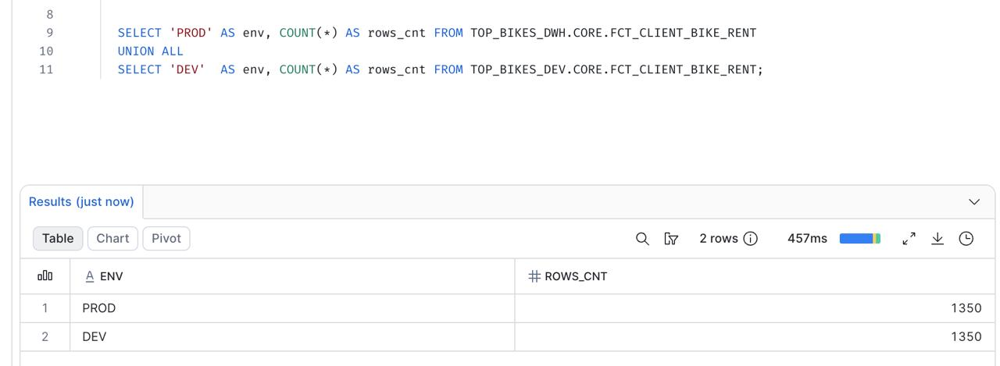
---
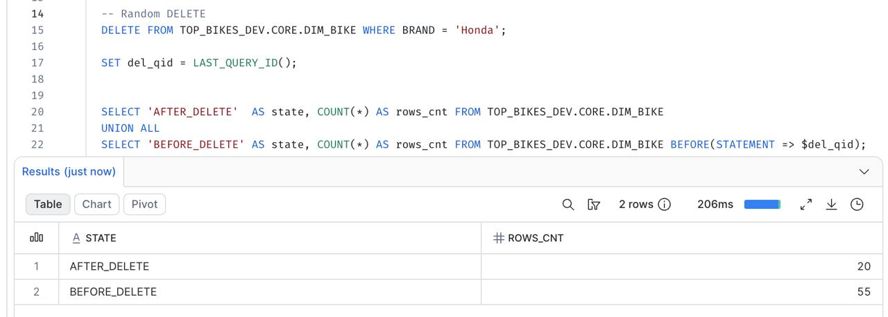
---
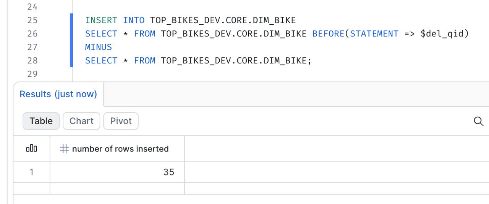
---
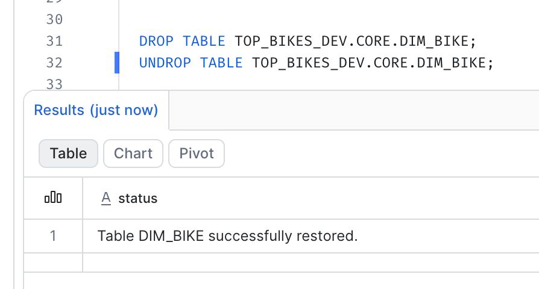
---
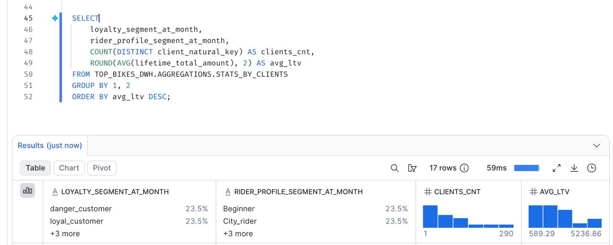
---
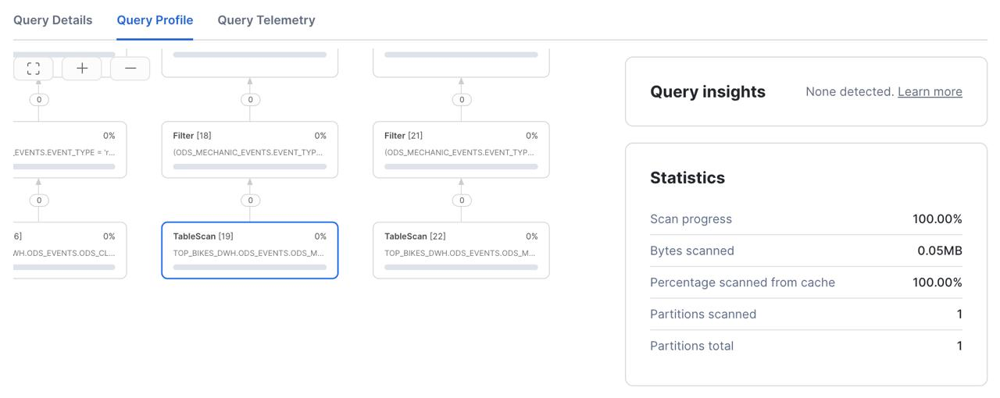
---
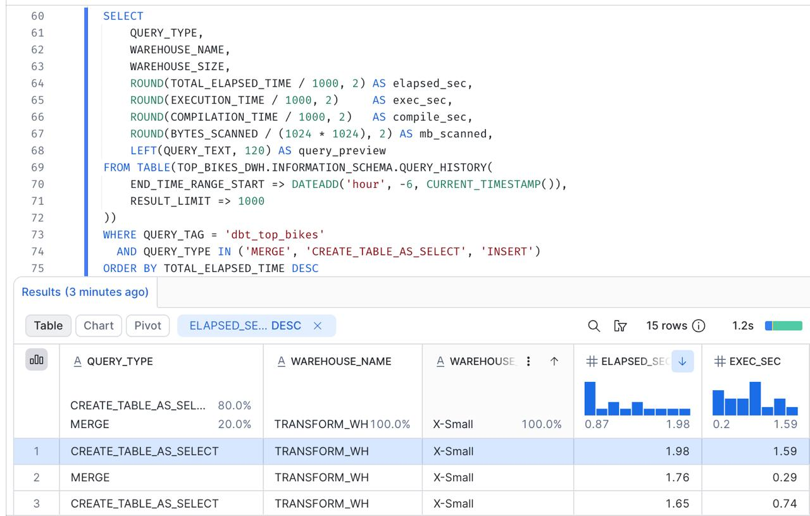
---
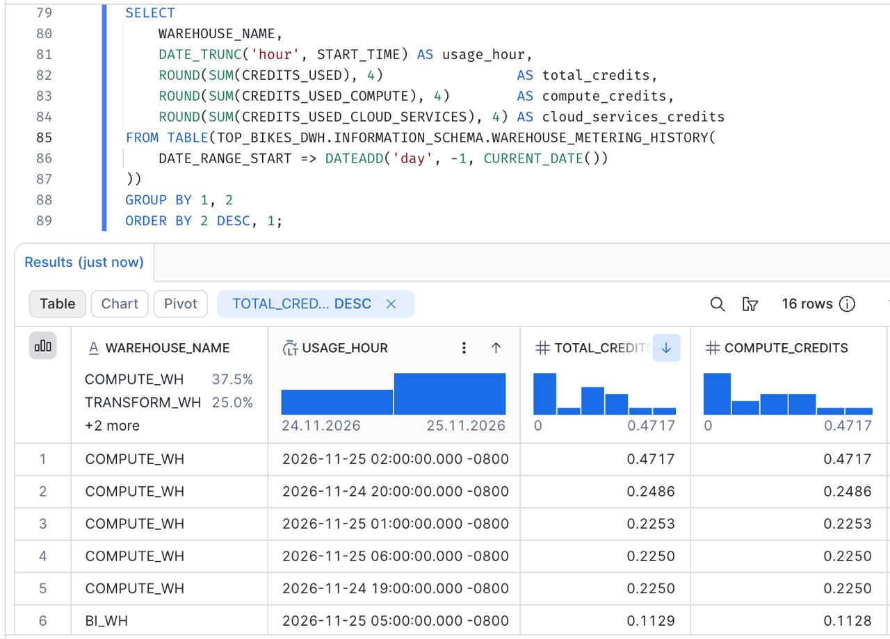
---
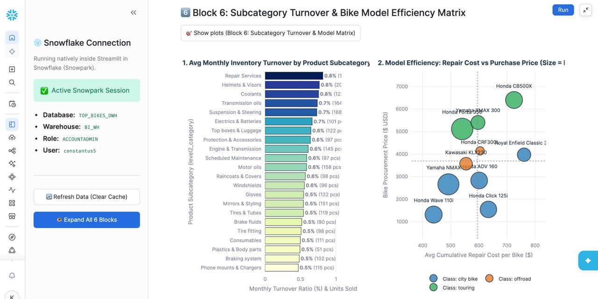
---
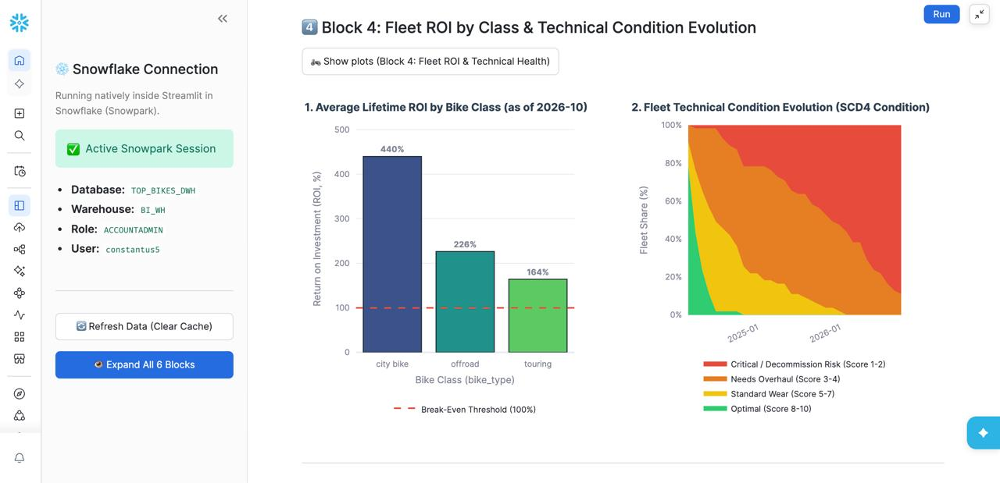
---
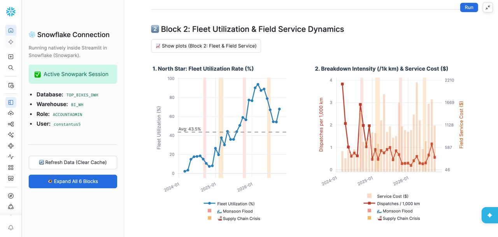
---
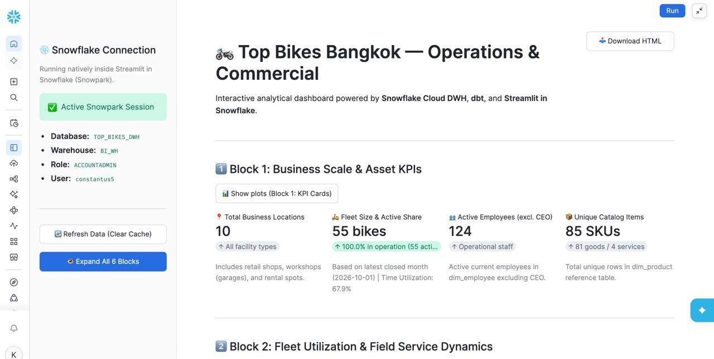
---

