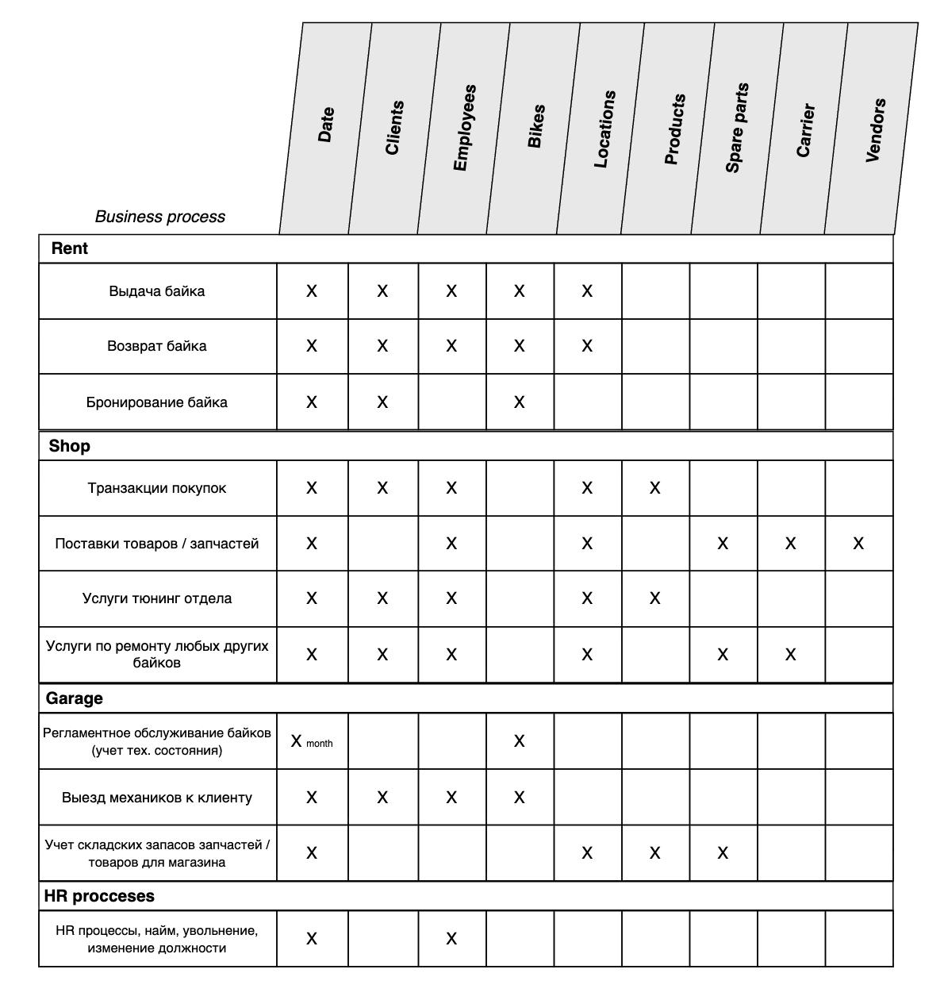

# Описание бизнес процессов

Опишем основные бизнес процессы нашего стартапа с точки зрения моделирования данных. Итак, бизнес представляет из себя крупный сервис по аренде байков (скутеров) в Бангкоке, а также включает в себя полноценный магазин, тюнинг отдел и мастерскую, которая занимается обслуживанием как байков, сдаваемых в аренду, так и любых других байков, привозимых клиентами на ремонт и обслуживание. Рассмотрим каждый отдел более детально.

## Отдел "Магазин"

Данный отдел включает в себя сам магазин, в котором клиенты могут покупать различные аксессуары и запчасти для байков, а также тюнинг подразделение, которое оказывает услуги по установке купленных аксессуаров и косметическому ремонту (не требующего значительного вмешательства в конструкцию байка). 

Отдел магазин напрямую взаимодействует с отделом "Мастерская (Garage)", поскольку именно отдел "Магазин" является входной точкой при закупке новых байков и запчастей для них. Отдел "Магазин" отвечает за своевременную закупку запчастей / байков и последующую их поставку (и при необходимости принимает возврат) в мастерскую и точки аренды. Если мастерской нужен новый двигатель на Honda Click, то механики делают запрос к коллегам из отдела "Магазин", которые уже в свою очередь начинают процесс закупки нужного списка запчастей. Аналогично коллеги из отдела "Аренда" могут запросить у Магазина закупку новой партии байков (на основе аналитики спроса и сезонности).

Также у клиента есть опция приехать в магазин и оформить полноценный ремонт своего байка (включая диагностику). Скажем, клиент приезжает на своем байке и хочет сделать полное обслуживание. Он покупает новые запчасти и другие аксессуары в магазине и оставляет байк в тюнинг отделе. Далее коллеги магазина связываются с коллегами из мастерской и отправляют им байк клиента для осуществления ремонта. После завершения работ, коллеги из отдела Мастерской отправляют байк обратно в магазин.

В отделе "Магазин" происходят следующие бизнес процессы:

 - **Транзации покупок**. События покупок товаров клиентами с гранулярностью до отдельной позиции в чеке. 
 - **Услуги тюнинг отдела**. События по установке купленных запчастей на байк клиента. Например, установка заднего кофра на Honda ADV 160. 
 - **Услуги по ремонту байков клиентов**. В данном случае речь идет о пайплайне ремонта байка клиента. Этот пайплайн включает в себя покупку нужных запчастей клиентом и последующую отправку байка в мастерскую, откуда после завершения работ байк будет снова отправлен в магазин и выдан клиенту. 
 - **Факты поставки запчастей или байков**. Здесь отражается полный пайплайн процесса закупок, взаимодействие с поставщиками и транспортными компаниями. Перемещения же запчастей между магазином и мастерской осуществляется посредством собственных грузовых пикапов компании (эти перемещения мы не будем отображать в модели данных из-за сложности реализации).

## Отдел "Мастерская (Garage)"

В этом подразделении происходит ремонт и регламентное обслуживание байков, которые сдаются в аренду, а также из отдела Магазин сюда присылают любые другие байки на ремонт. Данный отдел полностью изолирован от клиентов, то есть физически клиенты никак не взаимодействуют с локациями, где расположены мастерские (точнее сказать, локации, в которых располагаются только мастерские). В случае технической неисправности байка во время аренды клиент сперва звонит менеджерам в отдел "Аренда", которые уже в свою очередь связываются с механиками из мастерской для выезда кого-либо из них на место к клиенту. 

Также отдел Мастерской выступает в роли склада запчастей и временного хранения байков, которые не помещаются в пунктах аренды. Такими байками могут быть новые байки, которые еще не поставлены на учет (без номеров) или байки, ждущие ремонта пока доставляются новые запчасти. В общем, это необходимо для того, чтобы не захламлять точки аренды, где место сильно ограничено.

Бизнес процессы здесь следующие:

- **Регламентное обслуживание байков**. Речь идет о ведении календаря обслуживания байков, который логично относится именно к данному отделу. Разумеется, сами работы по замене масла, фильтров и т.п. производятся в мастерской. 
- **Выезд механиков к клиенту во время аренды**. Здесь имеет место быть процесс, когда клиенту нужна помощь с решением какой-либо технической проблемы и механик лично приезжает на указанную локацию, например, для замены спущенного колеса или зарядки аккумулятора.
- **Учет складских запасов запчастей**. В этом процессе очень важно участие мастерской, так как коллеги из магазина делают закупки запчастей, основываясь на запасах запчастей в мастерских. Запасы могут варьироваться в зависимости от качества, от частоты использования инструментов, случайных повреждений и т.п. Только механики могут точно сказать, что именно нужно для каждого байка.

## Отдел "Аренда"

Подразделение аренды занимается непосредственно управлением процесса выдачи и возврата байков клиентам, а также фиксации их технического состояния при возврате. Также в отделе аренды клиенты могут получать консультации по особенностям управления каждым байком и даже какие-либо туристические рекомендации по главным тревел маршрутам. Отдел аренды также заниматься клиентской поддержкой и принимает звонки с заявками на выезд механиков к клиенту для решения технических проблем.

Отдел аренды может взаимодействовать с отделом Магазина для консультации по вопросу закупок новых байков, шлемов и экипировки. Бизнес процессы здесь следующие:

- **Выдача байка**. Процесс выдачи байка клиенту с фиксацией технического состояния байка и фактической датой и стоимостью аренды. Если в течении срока аренды клиент хочет поменять байк, то для контроля и правильного сбора данных производится полный процесс возврата текущего байка и заведение нового факта аренды. Клиент также должен забронивать новый байк в своем приложении, завершив текущую аренду.
- **Возврат байка**. Факт возврата байка с фиксацией его технического состояния.
- **Бронирование байка в приложении**. Исключительно на стороне клиента. Бронирование включает в себя выбор байка и периода аренды.

## Bus matrix

*Здесь будет диаграмма метрик по бизнес процессам, дерево метрик, "роза ветров" стратегии аналитики и здесь же будет описание архитектуры аналитики*  

# Ключевые этапы преобразования данных и объекты bus matrix

Рассмотрим подробнее каждый этап ETL кухни, как именно организован процесс доставки и преобразования данных до BI слоя и бизнес пользователей.

**Сделать подробное описание по элементам всех систем, чтобы показать, что все учтено, просто некоторые этапы разработки опущены в связи с учебным проектом (речь идет о системах из главы 19 Кимбал)**

## Data Generator

Ядро симуляции бизнеса, написанное на Python. Это не просто скрипт для генерации случайных строк, а полноценный эмулятор бизнес-процессов стартапа (аренда байков, магазин, мастерская, HR, закупки складских запасов).

Технические особенности:

 - State Management (Управление состоянием): Генератор хранит в памяти текущие запасы, статусы байков (свободен/в ремонте) и открытые аренды. Состояние регулярно сериализуется в JSON-файл, что позволяет безопасно останавливать и перезапускать локальный проект без эффекта "амнезии".

 - Эмуляция SCD2 и Time Travel: Генератор умеет сдвигать виртуальное время и генерировать связанные события (например, изменение профиля клиента или кадровые переводы) со строгой хронологией, чтобы аналитическое хранилище корректно выстраивало историчность измерений.

## Kafka Consumer

Мост между стриминговой платформой (Redpanda/Kafka) и слоем Data Lake (S3 / MinIO). Скрипт подписывается на все бизнес-топики, собирает события в микро-батчи и раскладывает их по папкам (партицирование по датам и топикам) в формате NDJSON.

Технические особенности:

 - При локальной остановке контейнеров скрипт перехватывает системные сигналы (SIGTERM/SIGINT) и экстренно сбрасывает остатки буфера в S3. Это гарантирует нулевую потерю данных на границах батчей и защищает хранилище от эффекта "осиротевших" событий (например, когда возврат байка сохранился, а его бронирование потерялось в памяти убитого процесса). Хотя это и нельзя назвать полезным, так как после остановки проекта все равно невозможно подключиться к базе данных для контроля результатов работы генератора.

## S3 (MinIO) to PostgreSQL

Первый шаг ELT-пайплайна (Extract & Load), оркестрируемый через Apache Airflow. Скрипт скачивает сырые файлы из бакетов S3 за целевую дату и перекладывает их в реляционную базу данных.

Технические особенности:

 - Идемпотентность: Загрузка спроектирована так, чтобы таску можно было перезапускать бесконечное количество раз без задвоения данных. Используется паттерн предварительной очистки (DELETE записей за текущую дату) в связке с механизмом INSERT ... ON CONFLICT (event_id) DO NOTHING. Таким образом сырые данные, приходящие из генератора полностью перезаписываются в Postgresql в рамках одного дня, чего вполне достаточно для локального проекта.

## ODS events

Бронзовый слой данных в PostgreSQL. Выступает единым источником правды для всех сырых событий, прилетевших из систем-источников.

Технические особенности:

 - Слабая связность (Schemaless Payload): Таблицы имеют минималистичную структуру: уникальный идентификатор, тип события, временная метка и колонка payload типа JSONB. Использование JSONB позволяет базе легко переваривать любые изменения в структуре входящих событий без необходимости делать ALTER TABLE и перестраивать пайплайны загрузки. Такая архитектура крайне удобная, так как в последующих staging витринах, которые являются представлениями очень легко добавлять новые атрибуты событий. Достоточно просто добавить новые поля в коде view.

## Update strategy

## Staging (dbt)

Серебряный слой и входная точка трансформаций в dbt. Здесь сырые JSON-строки превращаются в плоские реляционные таблицы.

Технические особенности:

 - Жесткий контракт данных: Представления (views) на этом слое фильтруют общий пул событий по полю event_type и извлекают значения из payload, выполняя строгое приведение типов (casting) к ::date, ::numeric, ::boolean и т.д. Это защищает последующие витрины от неявных ошибок типизации.

## Core

Золотой слой готовых к анализу данных. Именно на этом этапе модель представляет из себя отражение вышеописанных бизнес процессов по bus matrix и является первым слоем, в который имеют доступ бизнес пользователи и к которому подключаются BI приложения. Опишем каждый объект модели данных в отдельности.

### fct_client_bike_rent

 
 Главная таблица фактов, которую можно отнести к накопительному снапшоту. Аренда байка это длительный процесс, своего рода пайплайн, который может быть растянут даже на несколько месяцев (но в нашем бизнесе не более, чем на 28 дней). Гранулярность витрины - клиент + байк + дата (datetime) аренды (фактически, данная гранулярность и описывается ключом rental_id). Клиент может брать в аренду сколько угодно байков и любые байки любое количество раз, но один байк может быть закреплен только за одним клиентом в данный момент времени. Иными словами, записи для данного клиента и данного байка не могут пересекаться по времени. Если клиент продлевает аренду, то заводится новая запись и проставляется флаг, что этот период аренды является продлением предыдущего. Также в эту витрину для удобства включается атрибут-флаг, который показывает факт выезда механика к клиенту при возникновении технической неисправности.

| column name                      | data type | description                                                   |
|----------------------------------|-----------|---------------------------------------------------------------|
| rental_id (PK) (DD)              | text      | Идентификатор факта аренды                                    |
| client_sk (FK)                   | text      | Идентификатор клиента (суррогатный ключ)                                       |
| bike_sk (FK)                     | text      | Идентификатор байка (суррогатный ключ)                                  |
| location_dis_id (FK)             | text      | Идентификатор точки выдачи байка                              |
| location_return_id (FK)          | text      | Идентификатор точки возврата байка                            |
| planned_start_date (FK)          | date      | Планируемая дата начала аренды                                |
| planned_end_date (FK)            | date      | Планируемая дата окончания аренды                             |
| fact_start_date (FK)             | date      | Фактическая дата начала аренды                                |
| fact_start_datetime            | timestamp      | Фактическая дата и время начала аренды                                |
| fact_end_date (FK)               | date      | Фактические дата окончания аренды                             |
| fact_end_datetime               | timestamp      | Фактические дата и время окончания аренды                             |
| rental_price_daily               | numeric   | Цена аренды в день                                            |
| deposit_amount                   | numeric   | Сумма залога                                                  |
| deposit_deducted_amount          | numeric   | Удержанная сумма из залога                                    |
| deduction_reason_code (FK)       | text      | Причина удержания части залога                                |
| discount_amount                  | numeric   | Сумма скидки                                                  |
| total_amount                     | numeric   | Итоговая стоимость аренды                                     |
| employee_disp_id (FK)            | text      | Идентификатор выдавшего байка сотрудника                      |
| employee_return_id (FK)          | text      | Идентификатор сотрудника, кто принял возврат байка            |
| actual_start_mileage             | numeric   | Пробег байка на начало аренды                                 |
| actual_end_mileage               | numeric   | Пробег байка после завершения аренды                          |
| fuel_start_percent               | numeric   | Уровень топлива на начало аренды                              |
| fuel_end_percent                 | numeric   | Уровень топлива после завершения аренды                       |
| pre_rental_condition_score (FK)  | int       | Оценка технического состояния байка перед выдачей             |
| post_rental_condition_score (FK) | int       | Оценка технического состояния байка после возврата            |
| helmets_issued_qty               | int       | Количество выданных шлемов                                    |
| rental_junk_sk               | text   | Внешний ключ, ссылающийся на junk dimension с флагами |
 

### dim_bike

 
 Измерение (справочник) байков, гранулярность - один уникальный байк. Принимаем, что нам не нужно хранить историю изменения атрибутов по байкам, данная витрина обновляется через полную перезапись (scd1). Исходные данные представлены в формате csv файла, загруженного в базу через seed dbt.

| column name               | data type | description                           |
|---------------------------|-----------|---------------------------------------|
| bike_sk (PK)              | text      | Идентификатор байка (суррогатный ключ)|
| bike_natural_key (NK)     | int       | Натуральный ключ байка                |
| WIN_number                | text      | ВИН номер байка                       |
| plate_number              | text      | Номер байка (табличка с номером)      |
| title                     | text      | Наименование модели                   |
| type                      | text      | Тип (класс) байка                     |
| model_year                | int       | Год модели                            |
| color                     | text      | Цвет                                  |
| brand                     | text      | Бренд                                 |
| hourse_power              | numeric   | Мощность в лс.                        |
| engine_volume (cc)        | int       | Объем двигателя (куб. см.)            |
| gearbox_type              | text      | Тип коробки передач                   |
| usb_charging_availability | boolean   | Флаг наличия USB порта зарядки        |
| procurement_price         | int       | Закупочная цена                       |
 

### dim_client

 
 Справочник клиентов, обновляется по стратегии scd2, гранулярность - суррогатный ключ клиента. В витрине присутствуют технические поля для отметок периода действия каждой записи, а также булевское поле, в котором проставляется флаг актуальной версии записей.
 
| column name              | data type | description                                   |
|--------------------------|-----------|-----------------------------------------------|
| client_sk (PK)           | text      | Идентификатор клиента (суррогатный ключ)      |
| client_natural_key (NK)  | text      | Идентификатор клиента (натуральный ключ)      |
| full_name                | text      | Полное имя клиента                            |
| gender                   | text      | Пол                                           |
| birthday                 | date      | Дата рождения                                 |
| salutation               | text      | Форма приветствия                             |
| preferred_payment_method | text      | Предпочитаемый метод оплаты                   |
| phone                    | text      | Мобильный телефон                             |
| email                    | text      | Электронная почта                             |
| nationality              | text      | Национальность                                |
| residential_address      | text      | Адрес проживания                              |
| driving_experience_years | int       | Количество лет (как опыт вождения)            |
| drive_license_category   | text      | Категория водительских прав                   |
| drive_license_verified   | boolean   | Факт наличия и актуальности водительских прав |
| rating_score             | int       | Внутренний рейтинг клиента                    |
| row_effective_date       | date      | Дата начала действия записи                   |
| row_expiration_date      | date      | Дата окончания действия записи                |
| current_row_indicator    | boolean   | Флаг актуальности записи                      |

### dim_calendar

 
 Классическое измерение календаря, включающая различные атрибуты дат, такие как номер дня недели, флаг рабочего дня или выходного, праздники, номера недель и т.п. Гранулярность - один день.

| column name         | data type | description                     |
|---------------------|-----------|---------------------------------|
| date (PK)           | date      | Дата                            |
| month_year          | text      | Месяц-год                       |
| quarter_year        | text      | Квартал-год                     |
| week_number         | int       | Номер недели                    |
| dow_number          | int       | Номер дня недели                |
| dow_text            | text      | Наименование дня недели         |
| is_holiday_flg      | boolean   | Флаг праздничного дня           |
| holiday_name        | text      | Название праздника              |
| date_key_int        | int       | Ключ даты                       |
| year_number         | int       | Номер года                      |
| quarter_number      | int       | Номер квартала                  |
| month_number        | int       | Номер месяца                    |
| month_name          | text      | Название месяца                 |
| month_name_short    | text      | Короткое название месяца        |
| day_of_month        | int       | Номер дня в месяце              |
| day_of_year         | int       | Номер дня в текущем году        |
| dow_text_short      | text      | Короткое название дня недели    |
| is_weekend_flag     | boolean   | Флаг выходного дня              |
| is_working_day_flag | boolean   | Флаг рабочего дня               |
| bkk_weather_season  | text      | Текущий сезон погоды в Бангкоке |
| week_start_date     | date      | Дата начала недели              |
| month_start_date    | date      | Дата начала месяца              |
| month_end_date      | date      | Дата последнего дня месяца      |
| is_month_end_flag   | boolean   | Флаг последнего дня месяца      |

### dim_rental_junk

 
 Классическое мусорное измерение (junk dimension), собирающее в себе комбинации низкокардинальных флагов, чтобы не засорять таблицу фактов. При этом в fct_client_bike_rent создается суррогатный ключ, ссылающийся на данное измерение. Для удобства использования в BI дашбордах флаги также объединены в комбинации по логике самих данных. 

| column name         | data type | description                     |
|---------------------|-----------|---------------------------------|
| rental_junk_sk (PK) | text      | Суррогатный ключ, определяет гранулярность  |
| helmet_damage_flag          | boolean      | Факт повреждения хотя бы одного шлема после завершения аренды                       |
| field_service_flag        | boolean      | Факт наличия хотя бы одного выезда механика к клиенту                     |
| rent_extend_flag         | boolean       | Факт продления аренды (после завершения текущей)                    |
| bike_exchange_flag          | boolean       | Факт замены байка и продления аренды                |
| return_status_category            | text      | Категория флага         |
 

### dim_employee

 
 Справочник сотрудников компании. Гранулярность - суррогатный ключ, история изменения атриубтов хранится по стратегии scd2. Также в модели данных присутствует таблица мост, которая хранит иерархию сотрудников и на которую ссылается dim_employee.

| column name               | data type | description                                                                           |
|---------------------------|-----------|---------------------------------------------------------------------------------------|
| employee_sk (PK)          | text      | Идентификатор сотрудника (суррогатный ключ)                                           |
| employee_natural_key (NK) | text      | Идентификатор сотрудника (натуральный ключ)                                           |
| full_name                 | text      | Полное имя сотрудника                                                                 |
| phone                     | text      | Мобильный телефон                                                                     |
| email                     | text      | Электронная почта                                                                     |
| position_title            | text      | Наименование должности сотрудника                                                     |
| grade_level               | text      | Уровень позиции сотрудника (джун, мидл и т.п.)                                        |
| assigned_location_id      | text      | Основная локация, за которой закреплен сотрудник                                      | 
| department                | text      | Наименование департамента (отдела)                                                    |
| can_dispense_return_flg   | boolean   | Флаг, показывающий допуск сотрудника для выдачи байка клиенту                         |
| can_field_service_flg     | boolean   | Флаг, показывающий допуск сотрудника для выезда к клиенту (для решения тех. проблемы) |
| can_workshop_repair_flg   | boolean   | Флаг, показывающий допуск сотрудника для работ по ремонту байка                       |
| can_sell_retail_flg       | boolean   | Флаг, показывающий допуск сотрудника для работы в отделе Магазина                     |
| row_effective_date        | date      | Дата начала действия записи                                                           |
| row_expiration_date       | date      | Дата завершения действия записи                                                       |
| manager_employee_id | text   | Идентификатор менеджера (руководителя) |
| is_active_flag | boolean   | Флаг, показывающий, что сотрудник работает |
| current_row_indicator     | boolean   | Флаг текущей актуальной записи                                                        |
 

### brg_emp_hierarchy

 Таблица мост, содержащая данные об иерархии сотрудников. Здесь заранее развернута транзитивная замкнутость (все связи «Руководитель — Подчиненный» на любую глубину, включая связь сотрудника с самим собой на уровне 0), а также показано количество ступеней между сотрудниками и флаг высшего и низшего ранга.

| column name                  | data type | description                                                 |
|------------------------------|-----------|-------------------------------------------------------------|
| manager_employee_id (FK)     | text      | Натуральный ключ руководителя                               |
| subordinate_employee_id (FK) | text      | Натуральный ключ подчиненного                               |
| hierarchy_depth (FK)         | int       | Глубина иерархии (кол-во ступений между двумя сотрудниками) |
| is_top_level_flg             | boolean   | Флаг высшей позиции                                         |
| is_bottom_level_flg          | boolean   | Флаг низшей позиции                                         |

### dim_location

 
 Справочник локаций, гранулярность - отдельная отдельная уникальная локация. Локация может быть как только мастерской, точкой аренды или магазином, так и комбинацией всех отделов. Например, точка аренды и магазин могут быть совмещены и физически располагаться в одном здании (в одной локации).

| column name               | data type | description                              |
|---------------------------|-----------|------------------------------------------|
| location_sk (PK)          | text      | Идентификатор локации (суррогатный ключ) |
| location_natural_key (NK) | text      | Идентификатор локации (натуральный ключ) |
| title                     | text      | Наименование локации                     |
| full_address              | text      | Адрес                                    |
| post index                | text      | Почтовый индекс                          |
| is_garage_flag            | boolean   | Флаг наличия мастерской                  |
| is_shop_flag              | boolean   | Флаг наличия магазина                    |
| is_warehouse_flag         | boolean   | Флаг наличия точки аренды                |
 

### dim_bike_condition

 
 Мы добавляем в таблицу фактов client_bike_rent ключ состояния байка (фактически, используем поле с оценкой состояния в качестве ключа), который ссылается на отдельное mini-dimension, состоящее из 10 строк - каждая строка будет описывать, что означает, например, состояние на 7. Сюда включены несколько атрибутов, (состояние двигателя, подвески, пластиковых элементов корпуса и диапазон пробега, например "less then 1000 km") Фактически, такое mini-dimension будет играть роль некого чек листа по выставлению механиком оценки состояния байка. А историю изменений мы будем отслеживать через основную таблицу фактов client_bike_rent. При этом таблица фактов аренды заполняется оценками, учитывая пробег байка на момент возврата в рентал. Иными словами, если для оценки 7 диапазон пробега варьируется от 3000 до 7000 км, и если возвращаемый байк преодолел 7000 км на одометре, то оценка состояния уже не может быть выше 6.

| column name                 | data type | description                              |
|-----------------------------|-----------|------------------------------------------|
| rental_condition_score (PK) | int       | Ключ уровня технического состояния байка |
| engine_condition            | text      | Состояние двигателя                      |
| plastic_condition           | text      | Состояние пластика (внешних элементов)   |
| suspension_condition        | text      | Состояние подвески                       |
| mileage_band                | text      | Диапазон пробега                         |
 

### dim_product

 
 Справочник всех товаров и услуг. Гранулярность - отдельный уникальный товар или услуга. Например, в данном измерении может как строка, содержащая наименование товара (шлем или перчатки), так и наименование услуги (установка ветрозащиты). В справочнике будут как обычные товары (аксессуары), так и запчасти на байки. На основе данного справочника создано несколько представлений view для удобство работы с разными типами товаров и услуг (например, отдельно view products для событий покупок в магазине и view spare parts для пайплайнов поставок).
 
| column name              | data type | description                                          |
|--------------------------|-----------|------------------------------------------------------|
| product_sk (PK)          | text      | Идентификатор товара (суррогатный ключ)              |
| product_natural_key (NK) | text      | Идентификатор товара (натуральный ключ)              |
| title                    | text      | Наименование товара                                  |
| level1_category          | text      | Наименование категории 1 уровня                      |
| level2_category          | text      | Наименование категории 2 уровня                      |
| manufactory              | text      | Производитель товара                                 |
| vendor (FK)              | text      | Ключ поставщика товара                               |
| is_spare_flag            | boolean   | Флаг, относится ли товар к категории запчастей       |
| is_tuning_flag           | boolean   | Флаг, относится ли "товар" к категории услуг тюнинга |

### dim_vendor

 Справочник поставщиков товаров и запчастей. Гранулярность - отдельный уникальный поставщик.

| column name             | data type | description                                           |
|-------------------------|-----------|-------------------------------------------------------|
| vendor_sk (PK)          | text      | Идентификатор вендора (поставщика) (суррогатный ключ) |
| vendor_natural_key (NK) | text      | Идентификатор вендора (поставщика) (натуральный ключ) |
| vendor_name             | text      | Наименование вендора                                  |
| is_foreign_flag         | boolean   | Флаг, является ли вендор иностранной компанией        |
| vendor_score            | int       | Внутренний рейтинг вендора                            |
| vendor_zip_postal_code  | text      | Почтовый код вендора                                  |
| vendor_address          | text      | Физический адрес юрлица вендора                       |
| vendor_mobile           | text      | Телефон или факс компании вендора                     |

### dim_carrier

 Справочник перевозчиков. Гранулярность - один уникальный перевозчик. Перевозчики могут быть как внутренними (из числа грузовых пикапов, работающих в нашей компании), так и представителями других компаний (обычно для поставок крупных партий запчастей или товаров из-за границы).

| column name              | data type | description                                    |
|--------------------------|-----------|------------------------------------------------|
| carrier_sk (PK)          | text      | Идентификатор перевозчика (суррогатный ключ)   |
| carrier_natural_key (NK) | text      | Идентификатор перевозчика (натуральный ключ)   |
| carrier_name             | text      | Наименование перевозчика                       |
| is_external_carrier_flag | boolean   | Флаг, является ли перевозчик внешней компанией |
| carrier_type             | text      | Тип перевозчика                                |
| carrier_score            | int       | Внутренний рейтинг перевозчика                 |
| carrier_status           | text      | Текущий статус перевозчика (свободен, занят)   |

### fct_shop_order

 
 Таблица фактов по событиям покупок товаров и услуг тюнинга в магазине. Тип фактов - транзакционная таблица. Гранулярность - отдельный уникальный чек + позиция товара (то есть чек + уникальный товар).

| column name        | data type | description                            |
|--------------------|-----------|----------------------------------------|
| shop_order_sk (PK) | text      | Идентификатор позиции в чека (определяет гранулярность) |
| order_id (DD) | text      | Идентификатор чека (заказа) в магазине |
| client_sk (FK)     | text      | Идентификатор клиента, внешний ключ    |
| employee_sk (FK)   | text      | Идентификатор сотрудника, внешний ключ |
| location_sk (FK)   | text      | Идентификатор локации, внешний ключ    |
| product_sk (FK)    | text      | Идентификатор товара, внешний ключ     |
| order_date (FK)    | date      | Дата покупки (ссылка на календарь)     |
| event_datetime    | timestamp      | Дата и время покупки    |
| total_amount       | numeric   | Итоговая стоимость позиции             |
| cnt_products       | int       | Количество товаров в позиции           |
| discount_amount    | numeric   | Сумма скидки на позицию                |
| basic_amount       | numeric   | Базовая стоимость позиции              |

### fct_procurement

 Таблица фактов по событиям закупок товаров и запчастей у поставщиков, накопительный снапшот. Гранулярность - идентификатор поставки + позиция товара/запчасти. Каждая поставка может длится несколько дней или даже недель, и в течении этого перида атрибуты события постепенно заполняются. Например, сначала проставляется дата оформления поставки, затем фактическая дата отправки со склада поставщика и так далее.
 
| column name                  | data type | description                                                            |
|------------------------------|-----------|------------------------------------------------------------------------|
| procurement_sk (PK)        | text      | Идентификатор поставки, первичный ключ, определяет гранулярность                                                |
| shipment_id (PK) (DD)        | text      | Идентификатор поставки                                                 |
| product_sk (FK)              | text      | Идентификатор позиции (товара в ней)                                   |
| vendor_sk(FK)               | text      | Идентификатор поставщика                                               |
| carrier_sk (FK)              | text      | Идентификатор перевозчика                                              |
| order_date (FK)              | date      | Дата заключения сделки о поставке                                      |
| event_timestamp              | timestamp      | Дата и время заключения сделки о поставке                                      |
| shipment_departure_date (FK) | date      | Фактическая дата начала пайплайна поставки (отправления от поставщика) |
| shipment_arrival_date (FK)   | date      | Дата прибытия поставки на локацию                                      |
| arrival_location_sk (FK)     | text      | Идентификатор локации, куда прибыла поставка                           |
| vendor_invoice_number (DD)   | text      | Идентификатор счета за поставку                                        |
| payment_check_number (DD)    | text      | Идентификатор чека после оплаты поставки                               |
| payment_amount               | numeric   | Сумма оплаты за данную позицию в поставке                              |
| product_quantity             | int       | Количество товаров в позиции                                           |

### fct_repair

 Таблица фактов (накопительный снапшот) с гранулярностью одного отдельного факта заказа ремонта байка показывает пайплайн ремонта байка, который клиент привез на обслуживание (речь идет именно о любых других байках, не тех, которые сдаются в аренду). В данном случае клиент привозит байк в магазин, где он сможет сразу купить нужные запчасти и затем байк отправляется в мастерскую вместе с запчастями.

| column name                    | data type | description                                                                                       |
|--------------------------------|-----------|---------------------------------------------------------------------------------------------------|
| repair_sk (PK)           | text      | Идентификатор пайплайна (первичный ключ, определяет гранулярность) ремонта                                                                   |
| repair_id (PK) (DD)            | text      | Идентификатор пайплайна ремонта                                                                   |
| order_id (DD)                  | text      | Идентификатор чека, в котором клиент купил нужны для ремонта запчасти (может быть Null)           |
| employee_sk (FK)               | text      | Идентификатор сотрудника, принимавшего байк клиента в магазине                                    |
| client_sk (FK)                 | text      | Идентификатор клиента                                                                             |
| carrier_sk (FK)                | text      | Идентификатор перевозчика (внутреннего грузового пикапа, на котором байк доставляют в мастерскую) |
| bike_name                      | text      | Название модели байка                                                                             |
| location_shop_sk (FK)          | text      | Идентификатор локации магазина                                                                    |
| location_garage_sk (FK)        | text      | Идентификатор локации мастерской, куда в итоге отвезут байк на ремонт                             |
| transportation_start_date (FK) | date      | Дата транспортировки байка из магазина в мастерскую                                               |
| transportation_end_date (FK)   | date      | Дата транспортировки байка из мастерской в магазин                                                |
| repair_start_date (FK)         | date      | Фактическая дата начала ремонта байка                                                             |
| repair_end_date (FK)           | date      | Фактическая дата окончания ремонта байка                                                          |
| invoice_total_amount           | numeric   | Итоговая стоимость ремонта                                                                        |
| invoice_discount_amount        | numeric   | Сумма скидки, предоставленной клиенту                                                             |
| event_datetime        | timestamp   | Дата и время регистрации события                                                              |

### fct_service_events

Таблица фактов (транзакционная таблица) с гранулярность одного факта выезда механика к клиенту. Данные здесь показывают факты выезда механиков из-за возникающих технических проблем с байками, таких как спущенное колесов, разрядившийся аккумулятор и т.п.

| column name                | data type | description                                                     |
|----------------------------|-----------|-----------------------------------------------------------------|
| service_event_sk (PK) | text      | Идентификатор события, первичный ключ, определяет гранулярность                 |
| service_event_id (PK) (DD) | text      | Идентификатор события выезда механика к клиенту                 |
| rental_id (FK)             | text      | Идентификатор текущей аренды, в рамках которой происходит выезд |
| client_sk (FK)             | text      | Идентификатор клиента                                           |
| bike_sk (FK)               | text      | Идентификатор байка                                             |
| event_date (FK)            | date      | Дата события                                                    |
| employee_sk (FK)           | text      | Идентификатор механика                                          |
| issue_category             | text      | Категория технической проблемы                                  |
| resolution_action          | text      | Результат решения                                               |
| service_cost_usd           | numeric   | Стоимость выезда и решения проблемы                             |
| client_fault_flag          | boolean   | Флаг, была ли проблема по вине клиента                          |
| event_datetime          | timestamp   | Дата и время события                          |

### fct_inventory_snapshot

Витрина по доступности (остаткам) товаров в мастерских и магазинах. Гранулярность витрины - товар + локация + неделя (периодический снапшот). В конце каждой недели витрина пополняется новым снимком, который включает фактическое количество товаров, также флаг того, есть ли хотя бы 1 доступный (свободный товар). Например, в одной мастерской в начале недели было два двигателя для Honda Click, но в течении недели привезли байк на замену двигателя. Двигатель будут менять на этой неделе и на следующей (этот процесс требует времени), но один из двигателей будет как бы на холде, забронированным, а значит доступных двигателей остается только один на конец недели. Помимо этого в конце недели будет фиксироваться факт того, заказан ли уже новый двигатель и предполагаемая дата поставки новой партии запчастей.

| column name           | data type | description                                                            |
|-----------------------|-----------|------------------------------------------------------------------------|
| inventory_snapshot_sk (PK)             | text      | Уникальный идентификатор снимка                                                     |
| snapshot_date_key             | text      | Ключ даты снимка                                    |
| week_year             | text      | Номер недели - год                                                     |
| product_sk (FK)       | text      | Идентификатор товара                                                   |
| location_sk (FK)      | text      | Идентификатор локации (мастерская или магазин)                         |
| product_quantity      | int       | Количество товара на конец недели                                      |
| available_flag        | boolean   | Есть ли хотя бы один свободный (доступный) товар                       |
| isin_shipment_flag    | boolean   | Флаг, показывающий, заказан ли уже данный товар на момент конца недели |
| planned_delivery_date | date      | Предполагаемая дата поставки товара                                    |

## Aggregations

*Описать цель каждой витрины, зачем она нужна, а также стратегию переноса большей части вычислений именно на уровень SQL, чтобы можно было легче поддерживать версионность, а BI приложения оставить только для визуализации и свести к минимуму преобразования данных внутри BI.*

1. Customer Intelligence (Customer 360)

Фокус на поведении, лояльности и монетизации клиентской базы.

 - RFM-сегментация
 - Когортный анализ (Retention/Churn), сегменты новичков, старичков, активных, отточных и т.п.
 - Расчет LTV (Lifetime Value) 

2. Asset & Operations Management (Операционная эффективность)

Фокус на утилизации активов (байков) и оптимизации цепочки поставок.

Сценарии: Fleet Utilization (процент времени, когда байк находится в аренде, а не в простое), оборачиваемость запасов (Inventory Turnover), анализ «бутылочных горлышек» в ремонтах (Lead Time ремонта), эффективность закупок.

Основа в нашем DWH: fct_inventory_snapshot, fct_procurement, fct_repair, fct_service_events.

Пример агрегата: agg_weekly_fleet_utilization (доля дней в аренде к доступным дням в разрезе моделей байков).

3. Retail & Revenue Performance (Коммерческая аналитика)

Фокус на движении товаров, маржинальности и структуре чека.

Сценарии: ABC/XYZ анализ запчастей и экипировки, Market Basket Analysis (совместные покупки), эластичность спроса от скидок, выявление сезонности (здесь идеально сыграет наш dim_calendar с погодой в Бангкоке).

Основа в нашем DWH: fct_shop_order, fct_inventory_snapshot, dim_product.

Пример агрегата: agg_daily_store_sales (тоталы продаж, количество чеков, средний чек, проникновение промо в разрезе dim_shop_location).

4. Workforce & HR Analytics (Производительность команды)

Фокус на утилизации рабочего времени, качестве сервиса и кадровой динамике.

Сценарии: Оценка нагрузки механиков (сколько выездов в день), Revenue per Employee (выручка на сотрудника магазина), текучесть кадров по грейдам.

Основа в нашем DWH: dim_employee (как SCD2 для отслеживания текучки и грейдов), fct_service_events, fct_shop_order.

Пример агрегата: agg_monthly_mechanic_performance (количество закрытых тикетов, средний чек ремонта и процент возвратов в разрезе каждого механика).

5. Специфичные метрики для пайплайна аренды

### Shrunken Subset Dimensions (role-playing)

### P&L allocation

## Tests (Data quality)

### Referential integrity

Автоматизированная система контроля качества данных, встроенная прямо в dbt-проект. Гарантирует, что данные не только консистентны технически, но и имеют бизнес-смысл.

Технические особенности:

 - Покрытие: Помимо базовых проверок (unique, not_null для суррогатных и натуральных ключей), реализованы сложные кастомные SQL-тесты. Они проверяют строгую хронологию пайплайнов (например, логистику ремонта), финансовую математику (скидки не превышают чек), ссылочную целостность SCD2 (отсутствие дыр и инверсий дат) и ролевую модель (сотрудник имел права на продажу) и т.п.

 - Паттерн CTE + UNION ALL: Сложные тесты собраны в единые файлы, где каждое бизнес-правило проверяется в своей CTE, а результаты объединяются с текстовым флагом ошибки (например, invalid_date_chronology). Это позволяет мгновенно локализовать проблему при дебаге.

*Подробнее раскрыть как и где реализованы 3 типа тестов, а именно: column tests, structure tests, business tests*.

## Audit

*Возможно добавить в одну или несколько таблиц фактов ключи для ссылки на справочники аудита, где например будет версия исходных загруженных данных, флаг валидации, флаг показывающий были ли ошибки при загрузке конкретной строки из таблицы фактов и так далее.*

## Grafana (Data observability)

Слой визуализации метрик пайплайна. Позволяет инженеру данных в реальном времени отслеживать "здоровье" хранилища, время пересчета витрин и статус прохождения проверок качества.

Технические особенности:

 - Кастомный парсинг артефактов: Вместо использования тяжелых и нестабильных dbt-пакетов, реализован собственный Python-парсер. На финальном этапе Airflow-дага скрипт читает системный файл run_results.json, извлекает метрики тестов и моделей и загружает их в схему audit в PostgreSQL.

 - Persisted Volumes: В локальной архитектуре (Docker Compose) база данных Grafana примонтирована к локальной директории хоста. Это гарантирует, что настроенные подключения и собранные дашборды переживут полное уничтожение и пересоздание контейнеров.