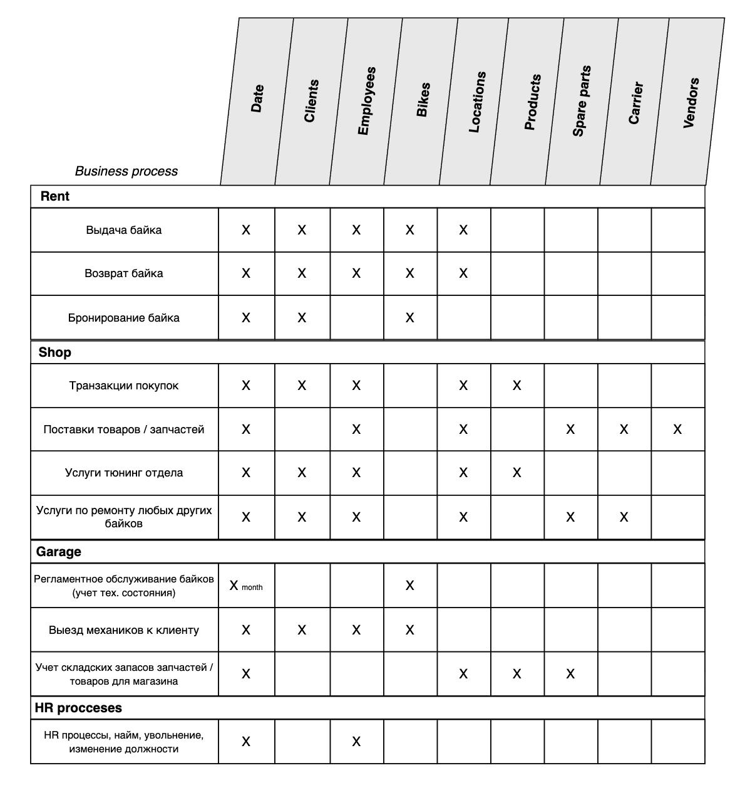

# В чем суть?

Опишем основные бизнес процессы нашего стартапа с точки зрения моделирования данных. Итак, бизнес представляет из себя крупный сервис по аренде байков (скутеров) в Бангкоке, а также включает в себя полноценный магазин, тюнинг отдел и мастерскую, которая занимается обслуживанием как байков, сдаваемых в аренду, так и любых других байков, привозимых клиентами на ремонт и обслуживание. Рассмотрим каждый отдел более детально.

## Отдел "Магазин"

Данный отдел включает в себя сам магазин, в котором клиенты могут покупать различные аксессуары и запчасти для байков, а также тюнинг подразделение, которое оказывает услуги по установке купленных аксессуаров и косметическому ремонту (не требующего значительного вмешательства в конструкцию байка). 

Отдел магазин напрямую взаимодействует с отделом "Мастерская (Garage)", поскольку именно отдел "Магазин" является входной точкой при закупке новых байков и запчастей для них. Отдел "Магазин" отвечает за своевременную закупку запчастей / байков и последующую их поставку (и при необходимости принимает возврат) в мастерскую и точки аренды. Если мастерской нужен новый двигатель на Honda Click, то механики делают запрос к коллегам из отдела "Магазин", которые уже в свою очередь начинают процесс закупки нужного списка запчастей. Аналогично коллеги из отдела "Аренда" могут запросить у Магазина закупку новой партии байков (на основе аналитики спроса и сезонности).

Также у клиента есть опция приехать в магазин и оформить полноценный ремонт своего байка (включая диагностику). Скажем, клиент приезжает на своем байке и хочет сделать полное обслуживание. Он покупает новые запчасти и другие аксессуары в магазине и оставляет байк в тюнинг отделе. Далее коллеги магазина связываются с коллегами из мастерской и отправляют им байк клиента для осуществления ремонта. После завершения работ, коллеги из отдела Мастерской отправляют байк обратно в магазин.

В отделе "Магазин" происходят следующие бизнес процессы:

 - **Транзации покупок**. События покупок товаров клиентами с гранулярностью до отдельной позиции в чеке. 
 - **Услуги тюнинг отдела**. События по установке купленных запчастей на байк клиента. Например, установка заднего кофра на Honda ADV 160. 
 - **Услуги по ремонту байков клиентов**. В данном случае речь идет о пайплайне ремонта байка клиента. Этот пайплайн включает в себя покупку нужных запчастей клиентом и последующую отправку байка в мастерскую, откуда после завершения работ байк будет снова отправлен в магазин и выдан клиенту. 
 - **Факты поставки запчастей или байков**. Здесь отражается полный пайплайн процесса закупок, взаимодействие с поставщиками и транспортными компаниями. Перемещения же запчастей между магазином и мастерской осуществляется посредством собственных грузовых пикапов компании (эти перемещения мы не будем отображать в модели данных из-за сложности реализации).

## Отдел "Мастерская (Garage)"

В этом подразделении происходит ремонт и регламентное обслуживание байков, которые сдаются в аренду, а также из отдела Магазин сюда присылают любые другие байки на ремонт. Данный отдел полностью изолирован от клиентов, то есть физически клиенты никак не взаимодействуют с локациями, где расположены мастерские (точнее сказать, локации, в которых располагаются только мастерские). В случае технической неисправности байка во время аренды клиент сперва звонит менеджерам в отдел "Аренда", которые уже в свою очередь связываются с механиками из мастерской для выезда кого-либо из них на место к клиенту. 

Также отдел Мастерской выступает в роли склада запчастей и временного хранения байков, которые не помещаются в пунктах аренды. Такими байками могут быть новые байки, которые еще не поставлены на учет (без номеров) или байки, ждущие ремонта пока доставляются новые запчасти. В общем, это необходимо для того, чтобы не захламлять точки аренды, где место сильно ограничено.

Бизнес процессы здесь следующие:

- **Регламентное обслуживание байков**. Речь идет о ведении календаря обслуживания байков, который логично относится именно к данному отделу. Разумеется, сами работы по замене масла, фильтров и т.п. производятся в мастерской. 
- **Выезд механиков к клиенту во время аренды**. Здесь имеет место быть процесс, когда клиенту нужна помощь с решением какой-либо технической проблемы и механик лично приезжает на указанную локацию, например, для замены спущенного колеса или зарядки аккумулятора.
- **Учет складских запасов запчастей**. В этом процессе очень важно участие мастерской, так как коллеги из магазина делают закупки запчастей, основываясь на запасах запчастей в мастерских. Запасы могут варьироваться в зависимости от качества, от частоты использования инструментов, случайных повреждений и т.п. Только механики могут точно сказать, что именно нужно для каждого байка.

## Отдел "Аренда"

Подразделение аренды занимается непосредственно управлением процесса выдачи и возврата байков клиентам, а также фиксации их технического состояния при возврате. Также в отделе аренды клиенты могут получать консультации по особенностям управления каждым байком и даже какие-либо туристические рекомендации по главным тревел маршрутам. Отдел аренды также заниматься клиентской поддержкой и принимает звонки с заявками на выезд механиков к клиенту для решения технических проблем.

Отдел аренды может взаимодействовать с отделом Магазина для консультации по вопросу закупок новых байков, шлемов и экипировки. Бизнес процессы здесь следующие:

- **Выдача байка**. Процесс выдачи байка клиенту с фиксацией технического состояния байка и фактической датой и стоимостью аренды. Если в течении срока аренды клиент хочет поменять байк, то для контроля и правильного сбора данных производится полный процесс возврата текущего байка и заведение нового факта аренды. Клиент также должен забронивать новый байк в своем приложении, завершив текущую аренду.
- **Возврат байка**. Факт возврата байка с фиксацией его технического состояния.
- **Бронирование байка в приложении**. Исключительно на стороне клиента. Бронирование включает в себя выбор байка и периода аренды.

## Bus matrix

*Здесь будет диаграмма метрик по бизнес процессам, дерево метрик, "роза ветров" стратегии аналитики и здесь же будет описание архитектуры аналитики*  

