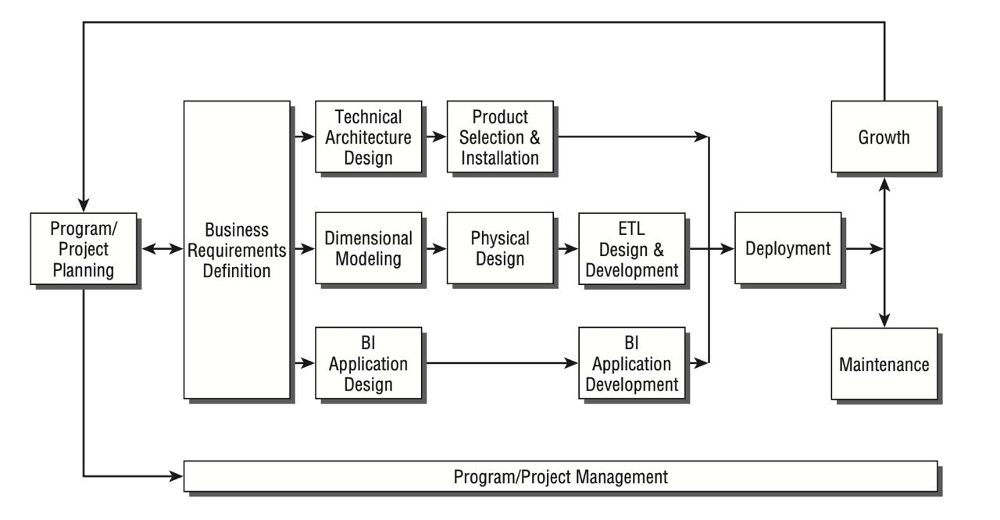

# Что представляет из себя проект?

Данный проект является открытой песочницей и призван наглядно продемонстрировать, как бы выглядил процесс имплементаци полного дата пайплайна в небольшом, но быстро развивающимся стартапе. В рамках проекта мы подразумеваем, что наш вымышленный бизнес не имеет вообще никакой ETL кухни для интеграции данных, а значит нам придется пройти весь путь от сбора сырых событий из клиентского приложения до построения готовых агрегированных витрин и дашбордов для аналитики. При этом мы будем придерживаться основных стандартов индустрии, а в качестве ключевой философской парадигмы будем основываться на следующей замечательной цитате:

 - There is no reason to tolerate an unstructured approach. 

Действительно, любая комплексная задача требует тщательного планирования и подготовки, чтобы мы и будем стараться подчеркивать в данном проекте.

Итак, давайте предположим, что мы имеем дело с развивающимся стартапом под названием Top bikes, который предоставляет услуги аренды байков (мотоциклов) в Бангкоке, а также имеет сеть магазинов аксессуаров и мотозапчастей. Наша задача - создать надежную и маштабируемую систему, которая позволит собирать и анализировать сырые данные, превращая их затем в полноценную бизнес стратегию. В качестве отправной точки у нас есть гипотетическое мобильное приложение для клиентов и другие мастер системы, из которых поступают данные о чеках в магазине, поставках товаров и прочее.

# Планирование и стратегия

Чтобы не утонуть в многообразии инструментов и не запутаться в определенни конечного результата, необходимо составить четкий план по реализации такой масштабной задачи. И такой план так или иначе будет соответствовать следующей схеме (Kimball Lifecycle diagram):

Далее мы будем двигаться шаг за шагом по каждому блоку диаграммы, углубляясь в каждый из этапов. Можно сказать, что данная схема представляет собой самую первую вернеуровневую декомпозицию проекта интеграции данных в компанию. 

## Структура документации (Kimball Lifecycle)

Документация проекта выстроена в строгом соответствии с жизненным циклом Кимбалла, который мы показали выше (Kimball Lifecycle) и разделена на 6 логических блоков:

* **[01. Сбор бизнес-требований и планирование (Business Requirements & Planning)](https://github.com/letConst55/data-pet-project/tree/main/docs/01_Business_Requirements_and_Planning)**
  Описание бизнес-модели стартапа по аренде байков, интервью со стейкхолдерами и определение целевых KPI.
* **[02. Техническая архитектура (Technical Architecture)](https://github.com/letConst55/data-pet-project/tree/main/docs/02_Technical_Architecture)**
  Обоснование выбора технологического стека (Redpanda, MinIO, PostgreSQL, dbt, Airflow) и обзор эмулятора генерации исходных событий.
* **[03. Многомерное моделирование (Dimensional Modeling)](https://github.com/letConst55/data-pet-project/tree/main/docs/03_Dimensional_Modeling)**
  Матрица корпоративной шины данных (Bus Matrix), проектирование логической модели (схема "Звезда") и стратегия физического развертывания.
* **[04. ETL-кухня (ETL Kitchen & Data Quality)](https://github.com/letConst55/data-pet-project/tree/main/docs/04_ETL_Kitchen)**
  Реализация ELT-пайплайнов (Kafka -> S3 -> PostgreSQL -> dbt), проекция на 34 подсистемы Кимбалла и встроенная система тестов качества данных с выводом аудита в Grafana.
* **[05. BI-приложения (BI Applications)](https://github.com/letConst55/data-pet-project/tree/main/docs/05_BI_Applications)**
  Проектирование слоя предвычисленных агрегаций и спецификации для аналитических дашбордов (Customer Intelligence, Fleet Utilization).
* **[06. Развертывание и эксплуатация (Deployment & Operations)](https://github.com/letConst55/data-pet-project/tree/main/docs/06_Deployment_and_Operations)**
  Оркестрация ELT-процессов через Apache Airflow и Bash-скрипты автоматизации для управления жизненным циклом инфраструктуры (start/stop pipeline).

### *Доступ к сервисам*

- Чтобы все включить 

`./start_pipeline.sh`

- Чтобы выключить

`./stop_pipeline.sh`

Креды для MiniO админки (http://localhost:9001/)

 - логин: minioadmin
 - пароль: miniopassword

Airflow http://localhost:8080/

 - логин: admin
 - пароль: 1234

Grafana http://localhost:3000/

 - логин: admin
 - пароль: 1234